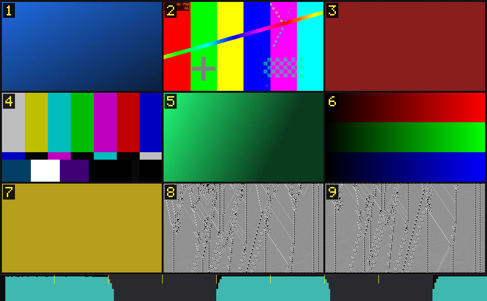

# dsh-video-storyboard · 中文说明

[](https://github.com/SAOS-3624/dsh-video-storyboard/actions/workflows/test.yml)

**给纯文本模型装一双"能翻页的眼睛"。**

输入一个视频，输出**一张可寻址的宫格图**：每格烧着编号、对应一段时间、下面挂着那段时间里说过的台词；底部还有一条与画面**同时间轴**的音频包络。模型因此可以「看」、可以「引用第 5 格」、可以「再放大看这 3 秒」，而不是被动接受一段别人写好的摘要。

> 社区项目，与 DeepSeek 官方无关。

**效果（实测数字）**：5 分钟片子 → **一张图**，9–16 帧只花 **384 token**；逐帧方案同样覆盖要 3,072–6,144。
90 秒 PV 扫描 9 秒，出 12 格、对齐 41 个切点。同一文件第二次调用 3.6 秒（命中缓存）。
不需要模型权重、不需要图像库、不需要字体配置。

## 算法做了什么（8 条，每条都是被真实素材打脸后改的）

| # | 做法 | 为什么不用那个更简单的做法 | 代码 |
|---|---|---|---|
| 1 | **HSV 三通道差做场景切换检测**（64×36，\|ΔH\|+\|ΔS\|+\|ΔV\| 取均值） | 只看亮度会漏掉"同亮度换色"的切点（测试片 9 个切点里 2 个是这种；`ffmpeg scdet` 找到 4/9，我们 9/9） | `src/scan.js` |
| 2 | **阈值按"速率"反推**：目标约 1.5 秒一个切点，分数下限 12 | `3×p95` 在 B-roll 上给 38（正常），在快剪动画上给 130 → **一个切点都没有**，正好死在最需要多格的内容上 | `src/scan.js` |
| 3 | **格位 = 局部剪辑率积分的等分点**，并吸附到真实剪辑点（位移 ≤ 理想格长 30%） | 均匀切会给"6 秒 20 刀"和"20 秒空镜"一样的空间；不设位移上限的吸附会把权重整个打乱 | `src/density.js` |
| 4 | **格数由画面运动 p90 决定**，不由时长决定 | 静态单镜头给 16 格 = 16 张一样的图；PV 给 4 格 = 什么都没看清 | `src/plan.js` |
| 5 | **最小间隔不超过素材自身粒度**（`min(minGap, 中位段长×0.9)`） | 固定 1.2 秒会把六个 1 秒镜头并成三个，然后就再也凑不够格数 | `src/segments.js` |
| 6 | **段内取最锐的一帧**：3 个候选比 Laplacian 方差 | `thumbnail=n=` 按直方图挑帧，而**模糊不改变直方图**——它会心安理得地选中一张糊掉的人员表 | `src/sheet.js` |
| 7 | **音频包络画在同一条时间轴上**，塞进同一张图 | 单独出一张音频图要多花 384 token，还丢了对齐——而对齐才是全部意义 | `src/audio.js`、`src/sheet.js` |
| 8 | **ASR 按 ≤45 秒切片、切点落在静音中点**，非语音段过滤并报出 | 299 秒单请求会把时间码整体压早 **13 秒**；纯音乐 PV 会吐出一条 29 秒的假台词、被贴到 5 个格子上 | `src/asr.js`、`src/pipeline.js` |

前人的工作、我们不打算超越的精度上限、以及刻意没做的事：**[docs/REFERENCES.md](docs/REFERENCES.md)**。

---



> 上图是它自己的输出：一段 27 秒的**合成**素材（9 个镜头、响—静—响的音频）→ 一张 9 格图 + 底部音频条带。
> 素材由 ffmpeg 现场生成，仓库里没有任何第三方视频画面。

## 先澄清一个常见误解

市面上不少介绍会把这类工具说成"**画面越乱分辨率越低**"。**本插件不是这样做的**，而且刻意没这么做：

- **格子尺寸全都一样**。快速剪辑的段落得到的是**更短的时段**（所以有更多帧），不是更小的格子。
- 原因是 token 账：一张图 384 token 是固定的，把格子缩小一半，模型看到的就是糊的——省不到钱，只丢信息。
- 时间轴**全覆盖**，但**不保证每个镜头都被看到**（5 分钟 300 个镜头塞进 16 格，物理上不可能）。要细节用 `video_zoom`。
- 连续运镜（快速摇镜、变焦）**不是切点**。任何帧差打分器（本工具、`scdet`、TransNetV2）都会给它高分，所以要做峰值抑制与碎段合并。

---

## 一、它到底解决了什么问题

纯文本模型看不到视频。现有三条路各有硬伤：

| 做法 | 硬伤 |
|---|---|
| 抽 N 帧、N 张图发给模型 | **每张图 384 token**，16 帧就是 6144。想看全片就破产 |
| 把帧发给外部视觉模型，回一段文字 | 回来的**是别人替你看过的结论**，不能追问、不能引用 |
| 只读字幕/ASR | 画面全丢。「这个镜头为什么好」这类问题永远答不了 |

我们走第四条：**把 N 帧打进一张图**。于是 384 token 就能看 9–16 帧，而且看的是**当前这个模型自己**。

---

## 二、三个真正新的地方

### 1. 打包，而不是逐帧 —— 同覆盖率下省 8–16 倍

| 方案 | 帧数 | 图数 | token |
|---|---|---|---|
| 本插件（9 格） | 9 | **1** | **384** |
| 本插件（16 格） | 16 | **1** | **384** |
| 逐帧插件 `count=8` | 8 | 8 | 3,072 |
| 逐帧插件 `count=64` | 64 | 64 | 24,576 |

代价是每帧分辨率：本插件一格约 68k 像素，逐帧方案每张可到 640k。**这不是缺陷，是分工**——先用 384 看清结构，需要细节时再花 384 调 `video_zoom`。逐帧方案把"看多少帧"和"每帧多清楚"绑死在一起，我们把它解耦了。

### 2. 可寻址 —— 编号是烧进像素的，不是排在文本里的

三重冗余，任何一层失效都还能定位：

- **烧进像素**：每格左上角一个高对比编号（默认格高 15%）
- **文本坐标**：`cell 5 (r2c2, image 1) = 00:01:12.40–00:01:22.80`
- **精确时间码**：同一行的 `frame@00:01:17.20`

为什么非要烧进像素：小模型**数格子会数错**（3×3 还算得清，4×4 就开始飘），但**读一个数字**很准。编号还做过下采样验证——整图降到每格 66×37 再放大，11% 格高的数字仍可辨认，所以默认取 15% 留余量。

### 3. 格位按内容密度分配 —— 不是均匀切

均匀采样有个隐蔽的错：**一个 20 秒的空镜和一个 6 秒里切了 20 刀的高潮，拿到的格数一样**。后者 19 个画面直接消失。

我们的做法：给时间轴算一条密度曲线

```
density(t) = clamp(局部剪辑率 / 全片平均剪辑率, 1, 2.5)
```

然后在**密度积分**上等分。密的地方格短帧多，静的地方格长，**但整段时间轴仍被完整覆盖**，格数与 token 一分不多。

实测一支 90 秒 PV、同样 9 格：

| | 格长范围 | 快切段（42–65s）拿到几格 |
|---|---|---|
| 均匀 | 4.5–9.6s | 2–3 |
| **自适应** | **3.9–10.6s** | **6** |

同一支片子的片尾标题卡，均匀版抽到的是"糊成一团的人员表"，自适应版抽到的是清晰的一格。

**诚实边界**：这保证「时间轴不漏」，**不保证每个镜头都被看到**。一支 5 分钟片子 300 个镜头、只给 16 格，物理上不可能全看。要更细就 `video_zoom`。

---

## 三、实现原理

整条链是**一次解码、多路复用**：扫描时只解码到 64×36，把切点、密度、音频、台词全部拿到，最后只为选中的格子各解 1–3 帧。

### 1. 探测

`ffprobe` 拿时长/帧率/旋转/音轨/字幕轨。两个细节：手机竖拍会带旋转元数据，要按显示方向算宽高比；片尾常有一帧黑场，取帧时避开最后一帧。

### 2. 切分：HSV 三通道差 + 速率法定阈值

把每帧缩到 **64×36**（2304 像素），转 HSV，与上一帧逐像素求 `(|ΔH|+|ΔS|+|ΔV|)/3`。选 HSV 而不是亮度差，是因为**同亮度换色**（红→蓝）在亮度域几乎为零：测试片里 9 个切点有 2 个是这种，`ffmpeg -vf scdet` 只找到 4/9，我们 9/9。

阈值**不是固定值，也不是分数的倍数**，而是按速率反推：

```
目标切点数 = min(帧数 × 25%, 时长 / gap)      // gap ≈ 1.5s，短片收紧到 0.5s
阈值 = 分数排序第 (帧数 - 目标) 位，向下取整，且 ≥ 12
```

这条是**被真实素材打脸后改的**：第一版用 `3 × p95`，在 B-roll 上很准（38 分 → 88 切点），但在快剪动画上 p95 已经是 43，×3 = 130 → **0 个切点**。越是需要多格的内容，倍数法越失效。

### 3. 分格：密度积分等分 + 吸附剪辑点

先按 0.1s 粒度建密度曲线（局部率要**箱型平滑**一遍，否则节奏均匀的片子会在每个切点附近鼓包、认出一堆假爆发），累积后按 `总积分/格数` 等分。切点会尝试吸附到真实剪辑点，但**位移超过理想格长的 30% 就放弃**——否则吸附会把权重分配整个打乱（踩过：全片被拉到剪辑点上，格长变得不均）。

### 4. 取帧：段内 3 候选，比 Laplacian 方差

| 策略 | 做法 | 问题 |
|---|---|---|
| `mid` | 取段中点 | 溶解/淡入的中点拿到叠影 |
| `thumb` | `thumbnail=n=` 取直方图最接近均值的帧 | 对**模糊→清晰**不敏感（模糊不改颜色分布） |
| **`sharp`（默认）** | 段内 3 个候选，比 Laplacian 方差取最大 | 无 |

真实案例：某 PV 的片尾人员表，`thumb` 在 84.88s 取到的是**高斯模糊帧**（文字全糊），`sharp` 在 85.20s 取到清晰帧——同一段、同一秒级窗口。

**反直觉的性能结果**：90s 片 / 9 格，`mid` 8.0s、**`sharp` 9.2s**、`thumb` 11.3s。锐度法比 `thumbnail` 还快，因为三次 seek 各解 1 帧，而 thumbnail 要**解码整段**才能统计直方图。

### 5. 拼图：零图像库、零字体依赖

取帧直接解成 `rgb24`，按 cell 尺寸做 cover 裁剪；宫格在普通 `Buffer` 上逐字节拼；编号用内置 5×7 点阵字模画；最后 `-f rawvideo -pix_fmt rgb24` 喂回 ffmpeg 出 PNG（或 `-f image2pipe` 直接给宿主）。

这一套把 Pillow / sharp / canvas / **fontconfig** 全部移出依赖图。最后那个不是洁癖：`drawtext` 需要字体系统，而 Windows 上的 fontconfig 经常是坏的——测试机上跑 `ffmpeg -vf drawtext` 直接报 `Cannot load default config file`。零字体依赖等于零这类事故。

### 6. 音频：条带与画面同轴

`ebur128` 抽瞬时响度（100ms/点）+ `silencedetect` 找停顿，然后画在宫格底部：**青色柱是响度、深灰块是静音、黄色刻度是切点**。

价值不在"能测响度"，而在**同一条时间轴**：模型能把"第 5 格"和"这里最响"直接对上，不用自己做时间映射。成本是同一张图内 **0 额外 token**，只占约 9% 像素预算。

它回答"哪里在响"，**不回答"为什么响"**。实测一支成片的响度全程只在 3 dB 内波动、与剪辑数相关 r=0.35——母带处理把动态压平了，靠响度找不出副歌。

### 7. 台词：三级降级 + 切片 + 幻觉过滤

```
字幕轨（免费、最准）→ OpenAI 兼容 ASR（本地/云）→ 都没有就跳过（分镜照出）
```

三个坑，都踩过：

| 坑 | 现象 | 处理 |
|---|---|---|
| **长请求漂移** | 单次 299s 请求，时间码整体压早 **13s**（≈4.5%，停顿被吃掉） | 客户端切 ≤45s，漂移降到 **0.02s** |
| **切片劈词** | 固定秒数切会把词切两半，段数凭空变多 | 切点吸附到静音中点 |
| **音乐段幻觉** | 纯音乐段吐出 29s / 9 字的假句子，按时间重叠被**贴到 5 个格子**上 | `时长 > 8s 且 < 0.8 字/秒` 判为幻觉丢弃，并在输出里报出丢弃条数（不静默丢） |

台词最后按**时间重叠**贴到格子上——一句跨两格时两边都保留，宁可重复也不让某格"没话说"。字/秒还作为**第三条密度信号**喂回去：话多的地方格更短。

### 8. 缓存

键 = `(路径, 大小, mtime, 窗口, 阈值策略)`。不 hash 文件内容（2GB 读一遍比重新扫描还慢），不缓存响度（2 小时有 7 万个点）。实测 5 分钟片子：首次 13.4s → 第二次 **3.6s**。这样 `video_storyboard` 之后再 `video_zoom`，同一段不会扫两遍。

---

## 四、为什么是这些取舍

**384 token/图 是硬约束**，所以「格数」和「每格清晰度」是零和的。整个设计围绕一件事：**把一次性的"看"拆成两段——先粗看结构，再按需放大**。

| 需求 | 做法 |
|---|---|
| 这片子讲了什么 | 9–16 格概览（384） |
| 第 1:12 发生了什么 | `video_zoom(from, to)`（384） |
| 一句台词在哪一格 | 清单直接给 `cell k = 时间码` |
| 音乐什么时候起来 | 底部条带（0 额外） |
| 一小时的电影怎么看 | `--plan 300` 分段，逐段 `--from/--to` |

---

## 五、实测基线

6 条 1080p 素材（B-roll / 动画正片 / 两支 PV / 特别 ED / 单镜头长take）：

| 素材 | 时长 | p90 | 自动阈值 | 切点 | 平均间隔 | 自动格数 |
|---|---|---|---|---|---|---|
| B-roll | 299s | 7.9 | 16 | 141 | 2.1s | 16×1 |
| 动画正片 | 1090s | 15.0 | 43 | 408 | 2.7s | 16×2 |
| 特别 ED | 80s | 11.6 | 21 | 42 | 1.9s | 4×1 |
| PV（正式） | 92s | 17.0 | 54 | 44 | 2.1s | 9×1 |
| PV（概念） | 90s | 26.1 | 58 | 41 | 2.2s | 9×1 |
| 单镜头 | 251s | 2.2 | 12 | 1 | — | 4×1 |

扫描速度：**22–47× 实时**（1080p，瓶颈是 H.264 解码，不是打分）。

台词密度还能反过来当类型判据（**响度与字/秒反向**）：

| 类型 | 字/秒 | 响度 |
|---|---|---|
| 口播教程 | 5.60 | −23 LUFS |
| 叙事动画 | 2.07 | −21.4 LUFS |
| 音乐 PV | **0.32** | **−14.2 LUFS** |

`字/秒 < 0.8 且响度 > −18` 基本可以判定"音乐驱动，别指望台词"。

---

## 六、边界：明确不做的事

- **不保证每个镜头都被看到**，只保证时间轴不漏。
- **不做音乐理解**。响度是测量，不是理解；情绪、曲风、副歌位置都不在范围内。
- **手机端未实测**（设计上零原生依赖，Termux 理论可行）。
- **超长视频解码是瓶颈**：2 小时片子首次约 5 分钟，降采样实测无收益（瓶颈在解码不在打分）。

---

## 七、后续改进方向

### P0（下一步就做）

1. **四条素材基线表**——把上面的表扩成同一张对照表（字/秒、响度、静音数、切点数四列），作为这个工具的第一份 benchmark。
2. **`video_probe` 工具**——只读容器头，几毫秒：时长/分辨率/有无音轨/切点密度。让模型先问再决定"9 格还是 16 格、要不要分段"，省掉一次盲试的 384 token。

### P1（ASR 侧，已有方案未落地）

3. **按内容类型自动分流**——`字/秒 < 0.8 && 响度 > −18` → 判定音乐片，多给格、少指望台词；口播片反之。这条已经有数据支撑，只差写进 `suggest()`。
4. **术语校对层**——ASR 对专业名词必错（实测 `彗差→绘插`、`八羽怪→巴与怪`、`收光圈→烧光圈`）。计划：清单里保留原文 + 标注"ASR 输出，引用前对画面核对"，并支持一份用户词典做替换。
5. **说话人分离**——多人对话视频里，"谁在说"和"说了什么"一样重要。SenseVoice 不直接给 speaker，需要接 `cam++` 之类的声纹模型。
6. **音乐段降级策略**——现在只是过滤幻觉；更进一步可以：检测到"长段低字/秒 + 高响度"时，自动把该段的格子权重调低（画面变化才是信息），并把音频条带加高。

### P2（工程化）

7. **抽样扫描**——超长视频（>1 小时）每 N 分钟只扫 30s，把 5 分钟降到 30s；代价是失去全局密度感知，需标 `degraded`。
8. **Termux 实测**——目前只有设计推演。
9. **npm 发布**——名字 `dsh-video-storyboard` 已确认未被占用。
10. **多语言**——目前中文口播效果最好；英文/日文的时间码与标点规则需要单独验证。

---

## 八、和其他视频插件怎么选

```
只想"看一眼这几帧"                → 逐帧类插件（更简单、无需全片扫描）
想让别的模型替我总结成一段话       → 桥接类插件（外部 VLM）
想知道"整片怎么组织、第几分钟发生了什么、谁在说什么"
                                 → 本插件（video_storyboard + video_zoom）
只想分析一首歌                     → 音乐分析类插件
```

## 许可

MIT。不复制任何第三方源码；ffmpeg、模型权重、视频素材都不随仓库分发。ASR 默认对接用户自建的 OpenAI 兼容端点（如 SenseVoiceSmall，FunAudioLLM / 阿里，遵循 FunASR Model License v1.1，保留署名）。
